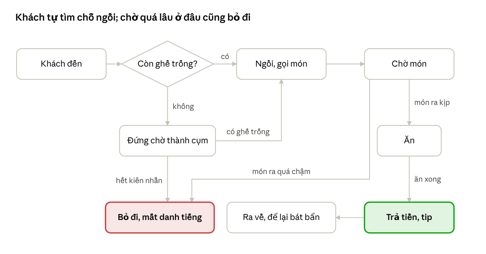

# Phở Phố Cổ – Tài liệu thiết kế game

Cập nhật 28/10/2026 · Bản gốc (sửa và bình luận được): https://claude.ai/artifact/NxshHNussP1GVYWfq7qL8y

## Tổng quan

Người chơi tiếp quản gánh phở của bà ở phố cổ Hà Nội cuối thập niên 80, rồi phát triển nó thành quán bún phở nổi tiếng nhất phố. Đây là game phục vụ theo thời gian, nhưng mỗi bát được nấu bằng thao tác tay thật sự. Tên tạm: **Phở Phố Cổ**.

| Hạng mục            | Định hướng                                                                                                           |
|---------------------|----------------------------------------------------------------------------------------------------------------------|
| Thể loại            | Phục vụ theo thời gian + thao tác nấu từng bước (đã chốt)                                                            |
| Phong cách          | Chibi hiện đại, điểm xuyết họa tiết Việt (đã chốt)                                                                   |
| Bối cảnh            | Hà Nội phố cổ cuối thập niên 80 đầu 90 (đã chốt)                                                                     |
| Nền tảng            | iOS và Android, màn hình ngang,                                                                                      |
| sẽ chỉ có 1 màn     | tạm thời để 12h quán sẽ phải dóng cửa . hoặc tự động đóng cửa khi chọn đóng cửa ( có phần đóng mở cửa để khách vào ) |
| Người chơi mục tiêu | 12 tuổi trở lên; người Việt trong và ngoài nước, người nước ngoài thích ẩm thực Việt                                 |
| Engine đề xuất      | Unity (2D + Spine cho hoạt ảnh) hoặc Godot nếu đội nhỏ                                                               |

Ba trụ cảm xúc của game:

- **Ấm áp, hoài niệm:** phố cũ, tiếng rao, khói bếp, những vị khách quen.

- **Nấu đã tay:** chần bánh, chan nước, rắc hành có nhịp và có cảm giác.

- **Quán lớn dần:** từ một gánh hàng thành cửa hàng mặt phố, người chơi nhìn thấy rõ công sức của mình.

## Câu chuyện và cốt truyện

cốt truyện ở đây chỉ là giới thiệu hướng dẫn người chơi về các tính năng của ứng dụng quán phở . hướng dẫn lần đầu cho người mới

## Phong cách hình ảnh

Nhân vật chibi mềm mại đứng trong một phố cổ vẽ tay ấm màu, có vân giấy dó phủ nhẹ. Chất Việt nằm ở họa tiết, vật liệu và đồ vật thật của thời đó, không ở việc vẽ theo lối tranh cổ.

**Nhân vật:** tỉ lệ đầu khoảng 1/2,5 chiều cao, mắt to, biểu cảm rõ để đọc được trên màn hình nhỏ. Nét viền màu nâu đậm thay vì đen, đổ bóng 2 tông. Trang phục đúng thời: áo sơ mi cộc tay, quần âu, nón lá, mũ cối, khăn quàng đỏ học sinh, áo bô đội.

**Họa tiết và chất liệu Việt:**

- Gạch bông lát nền, tường vôi vàng bạc màu, mái ngói âm dương phủ rêu, cửa gỗ ô hộp.

- Bát đĩa men lam Bát Tràng, đũa tre, nồi nhôm móp, bếp than tổ ong.

- Tranh Đông Hồ treo tường làm đồ trang trí mua được.

- Khung giao diện viền gỗ sơn son, góc có họa tiết trống đồng giản lược.

- Biển hiệu chữ sơn tay, cây hoa sữa, dây điện chằng chịt, xe đạp, xích lô, tàu điện chạy ngang nền.

| Bảng màu  | Màu chính                                          | Dùng cho                           |
|-----------|----------------------------------------------------|------------------------------------|
| Ban ngày  | Vàng vôi, đỏ gạch, xanh rêu, nâu gỗ, trắng men lam | Tường, mái, đồ gỗ, bát đĩa         |
| Ban đêm   | Cam đèn sợi đốt, xanh tím trời đêm, vàng đèn dầu   | Ánh sáng quán, cửa sổ nhà hàng xóm |
| Điểm nhấn | Đỏ son, vàng kim                                   | Nút bấm, phần thưởng, khách VIP    |
|           |                                                    |                                    |

**Góc nhìn đề xuất:** màn hình dọc, góc 3/4 nhìn nghiêng từ trên xuống. Khu bếp và quầy nằm ở 1/3 dưới màn hình, vừa tầm ngón cái. Khu bàn ghế và đường phố nằm phía trên, để người chơi thấy khách đi vào và ra về.

**Hoạt ảnh:** nhân vật 2D dựng xương bằng Spine, để một bộ xương dùng chung cho nhiều kiểu khách, chỉ thay đầu, tóc, áo. Khói bốc từ nồi và bát phở là hiệu ứng quan trọng nhất, cần đẹp và luôn chuyển động.

## Lối chơi và các bước nấu

Chỉ có một màn duy nhất

1.  **Sáng sớm, chuẩn bị (không tính giờ):** ninh nước dùng và nhập nguyên liệu. Nước dùng ninh tốt thì cả ngày được cộng điểm chất lượng.

2.  khách đến, gọi món, người chơi nấu và phục vụ, dọn bàn.  
    phải có cơ chế phần khách vào quán khi nào ít khi nào đông khi nào gặp khách khó tính . ( khách hài lòng bao nhiêu theo muwcd độ từ đó nhận được số tiền tip tương ứng )

3.  **Đóng hàng, tổng kết:** doanh thu, tiền tip, số khách hài lòng, sao của ngày (tối đa 5).

4.  **Nâng cấp:** mua dụng cụ, trang trí, thuê người, rồi sang ngày mới.

### Phở bò: món mẫu

Chuẩn bị buổi sáng gồm 3 mini-game ngắn, mỗi cái khoảng 10 giây:

- **Nướng gừng, hành:** kéo củ lên than, lật khi vỏ vừa xém.

- **Rang gia vị:** quế, hồi, thảo quả. Lắc chảo, dừng khi thơm (biểu tượng khói vàng); quá tay thì cháy.

- **Ninh xương:** giữ lửa trong vùng xanh và hớt bọt khi nổi lên.

Mỗi bát khi mở hàng:

1.  **Lấy bát:** chạm vào chồng bát, bát đặt vào ô trống trên bàn bếp.

2.  **Chần bánh:** kéo nắm bánh phở vào rổ chần, nhúng vào nồi nước sôi. Thanh tiến trình chạy khoảng 2 giây; nhấc lên đúng vùng xanh. Chần lâu quá thì bánh nát.

3.  **Đổ bánh vào bát:** vuốt rổ về phía bát.

4.  **Xếp thịt theo order:** kéo thả tái (thái lát mỏng, để sống), chín, nạm, gầu.

5.  **Chan nước dùng:** giữ ngón tay để môi rót, thả tay khi nước đến vạch. Nước nóng làm thịt tái chuyển màu ngay trên màn hình.

6.  **Rắc hành, tiêu:** chạm vào từng hũ; order có thể ghi “không hành” hoặc “nhiều hành”.

7.  **Phục vụ:** kéo bát đến khách, hoặc đặt lên quầy để nhân viên bưng ra.

Món kèm: quẩy, trứng chần, trà đá. Chanh, ớt, tỏi ngâm dấm để sẵn trên bàn, khách tự lấy; hũ hết thì phải ra rót thêm.

**Chấm điểm mỗi bát:** đúng order, độ hoàn hảo (bánh, lượng nước, nước còn nóng) và tốc độ. Điểm quyết định tiền tip và biểu cảm của khách. Khi nâng cấp (rổ chần nhiều ngăn, thịt thái sẵn), số thao tác giảm dần để người chơi phục vụ được nhiều khách hơn.

**Order hiển thị bằng hình**, không dùng chữ: bong bóng thoại trên đầu khách có hình bát, miếng thịt tái hoặc chín, hành bị gạch chéo, quẩy.

### Các món khác

| Món               | Chương  | Các bước chính                                    | Thao tác riêng                                           |
|-------------------|---------|---------------------------------------------------|----------------------------------------------------------|
| Phở gà            | 2       | Chần bánh, xé gà, lá chanh thái chỉ, chan nước gà | Vuốt để xé gà thành sợi                                  |
| Bún chả           | 2       | Nướng chả, pha nước chấm, bún, rau sống           | Lật vỉ đúng lúc, quạt than khi lửa yếu                   |
| Bún riêu cua      | 3       | Giã cua, lọc, nấu riêu, đậu rán, cà chua          | Giã cối theo nhịp; riêu nổi đẹp thì được thêm điểm       |
| Bún thang         | 3 (Tết) | Trứng tráng, giò lụa, gà xé, xếp lên bún          | Xếp topping thành hình đẹp, càng cân đối càng nhiều điểm |
| Bánh cuốn         | 4       | Tráng bột, đậy vung, gỡ bánh, cuốn nhân           | Rót bột theo vòng tròn đều tay                           |
| Bún ốc            | 4       | Luộc ốc, khêu ốc, nước chua, rau                  | Khêu ốc bằng thao tác xoay ngón tay                      |
| Phở cuốn, phở xào | 5       | Cuốn bánh với thịt và rau; xào bánh trên chảo     | Cuốn chặt tay; đảo chảo theo nhịp                        |

## Bối cảnh quán

Quán trải qua 4 hình dạng theo cốt truyện. Mỗi hình dạng thay đổi cả cách khách ngồi lẫn cách người chơi phục vụ.

| Giai đoạn       | Bố cục                                                                                          | Sức chứa         | Cách phục vụ                              |
|-----------------|-------------------------------------------------------------------------------------------------|------------------|-------------------------------------------|
| Gánh hàng       | Đòn gánh, một đầu nồi nước dùng trên bếp than, đầu kia bát đũa, bánh, thịt; vài ghế đẩu gỗ thấp | 4 khách          | Khách ngồi quanh gánh, Na đưa bát tận tay |
| Vỉa hè          | Bếp than tổ ong, bàn gỗ thấp, ghế đẩu, mái bạt che, xô rửa bát                                  | 8 đến 12 khách   | Khách tự tìm ghế, người chơi bưng ra      |
| Gian nhà ống    | Nền gạch bông, quạt trần, bàn ghế gỗ, bếp và quầy ở cửa, bàn phía trong                         | 16 đến 20 khách  | Khách gọi món tại bàn, nhân viên bưng     |
| Nhà ống mở rộng | Thêm gác xép, phá tường thông sang nhà bên, bãi giữ xe                                          | 30 khách trở lên | Nhiều khu, nhiều nhân viên                |

**Nền phố luôn chuyển động:** tàu điện leng keng chạy ngang, người đạp xe, xích lô chờ khách, bà hàng nước đầu ngõ, cây hoa sữa rụng lá, loa phường phát tin buổi sáng.

### Các buổi trong ngày

- **Sáng sớm (đông nhất):** sương mỏng, khói nồi bốc cao. Khách đi làm vội, ít kiên nhẫn.

- **Trưa:** nắng vàng, khách thưa. Lúc này có khách du lịch và học sinh tan trường.

- **Tối:** bật đèn sợi đốt vàng cam dưới mái hiên, ánh đèn hắt từ cửa sổ nhà bên, khói bếp ánh lên trong ánh đèn. Ở giai đoạn gánh hàng thì dùng đèn dầu. Khách tối là thanh niên đi chơi, người làm ca đêm; họ ngồi lâu, trò chuyện và gọi thêm.

- **Phở đêm (mở từ chương 3):** màn đặc biệt sau 22 giờ. Khách ít nhưng trả gấp đôi, phố vắng, mèo trèo mái ngói, nhạc chậm hơn.

### Thời tiết và mùa lễ

| Sự kiện          | Thay đổi hình ảnh                       | Ảnh hưởng lối chơi                                              |
|------------------|-----------------------------------------|-----------------------------------------------------------------|
| Mưa phùn         | Áo mưa nilon, ô, nền ướt phản chiếu đèn | Khách chỉ ngồi chỗ có mái; có người trú mưa ghé ăn              |
| Gió mùa đông bắc | Khăn len, áo bông, hơi thở trắng        | Khách gọi phở nóng nhiều hơn, tip cao hơn; nước nguội nhanh hơn |
| Trung thu        | Đèn ông sao, trẻ con rước đèn qua phố   | Đoàn trẻ em ghé cùng lúc; trang trí theo mùa                    |
| Tết              | Cành đào, câu đối, pháo giấy đỏ         | Khách đông nhất năm, mở bún thang, tiền mừng tuổi thưởng        |
| Mất điện         | Cả phố tối, chỉ còn đèn dầu             | Tầm nhìn hẹp, bếp than vẫn chạy                                 |

## Khách hàng và nhân vật phụ

Khách vào quán theo kiểu “lộn xộn có trật tự” đúng chất quán Việt. Khách tự tìm ghế trống và ngồi gọi món. Hết ghế thì họ đứng chờ thành cụm trước cửa, không xếp hàng thẳng. Mỗi khách đang chờ có số thứ tự nhỏ trên đầu để người chơi không bị rối.

hành trình của khách · 2 điểm có thể bỏ đi

Khách có thể bỏ đi ở hai lúc: khi đứng chờ ghế và khi chờ món. Ra về vui vẻ thì để lại bát bẩn, người chơi phải dọn trước khi khách mới ngồi.

### Các kiểu khách

| Kiểu khách                  | Ngoại hình                          | Dáng đi                            | Kiên nhẫn  | Hành vi riêng                                         |
|-----------------------------|-------------------------------------|------------------------------------|------------|-------------------------------------------------------|
| Công nhân viên đi làm       | Sơ mi cộc tay, cặp da, dắt xe đạp   | Đi nhanh, liếc đồng hồ tay         | Thấp       | Đông vào buổi sáng, ăn nhanh, tip ít                  |
| Bác xích lô Ba (khách quen) | Áo may ô, khăn mặt vắt vai          | Lững thững, lau mồ hôi             | Cao        | Gọi thêm quẩy, hay kể chuyện phố                      |
| Học sinh                    | Khăn quàng đỏ, cặp sách             | Chạy nhảy, đi theo nhóm 2 đến 3 em | Trung bình | Ít tiền, gọi bát nhỏ, đùa nhau khi chờ                |
| Cụ già                      | Áo đại cán hoặc áo bà ba, chống gậy | Đi chậm, dừng lại ngắm phố         | Rất cao    | Khảo nước dùng; khen thì quán tăng danh tiếng         |
| Bà nội trợ đi chợ           | Nón lá, làn mây đầy rau             | Đi nhanh, nhìn ngang ngó           | Trung bình | Đôi khi mua mang về                                   |
| Anh bộ đội về phép          | Áo xanh, mũ cối, ba lô con cóc      | Thẳng lưng, bước đều               | Cao        | Ăn 2 bát liền                                         |
| Khách Tây ba lô             | Ba lô to, cầm bản đồ                | Ngơ ngác nhìn quanh, đi vòng vòng  | Trung bình | Tip cao; có người không ăn rau mùi, phải đọc order kỹ |
| Nhà phê bình bí ẩn (VIP)    | Mũ phớt, áo măng tô, sổ tay         | Chậm, quan sát quán                | Trung bình | Đến ngẫu nhiên, bát hoàn hảo thì được thưởng lớn      |
| Mèo hàng xóm                | Mèo mướp                            | Trèo rào, nằm dưới ghế             | Không      | Chi tiết vui, cho ăn thì mở trang phục ẩn             |

### Biểu cảm theo tâm trạng

- **Vừa vào, vui:** mắt cười, hít hà mùi nước dùng, biểu tượng làn khói thơm trên đầu.

- **Đang chờ:** gõ đũa xuống bàn, chống cằm, nhìn về phía bếp.

- **Sốt ruột:** giậm chân, xem đồng hồ, mặt đỏ dần, đám mây nhỏ bốc trên đầu. Vòng kiên nhẫn quanh chân chuyển từ xanh sang vàng rồi đỏ.

- **Đang ăn:** xì xụp, thổi cho nguội, toát mồ hôi trán khi ăn ớt, vắt chanh.

- **Rất hài lòng:** xoa bụng, giơ ngón cái, tiền tip bay lên.

- **Không hài lòng:** lắc đầu, đẩy bát ra, lẩm bẩm (bong bóng ký hiệu rối).

### Khách ra về

- **Hài lòng:** đặt đũa ngang miệng bát, lau miệng bằng giấy, trả tiền tại bàn, rút tăm, vẫy tay chào rồi dắt xe đạp đi. Khách quen đi ngang quầy nói “mai bác lại đến”.

- **Không hài lòng:** trả tiền không tip, đi nhanh, không ngoái lại.

- **Bỏ đi vì chờ lâu:** đứng dậy phẩy tay, quán mất một ít danh tiếng. Nếu bát đã được mang ra thì bát đó bị bỏ phí.

- **Sau khi khách đi:** bát bẩn ở lại trên bàn. Chưa dọn thì khách mới không ngồi chỗ đó.

### Chen ngang

Thi thoảng có khách chen lên trước cụm đang chờ. Người chơi chạm vào để “nhắc khéo”, khách đó gãi đầu cười trừ về sau. Bỏ qua thì các khách khác bị giảm kiên nhẫn.

## Nhân viên quán

Chương 1 và 2, Na làm một mình. Từ chương 3, người chơi thuê dần nhân viên để giao bớt việc. Mỗi người có tính cách riêng và lên cấp được.

| Nhân viên               | Việc                                  | Mở ở     | Đặc điểm hoạt ảnh                                               |
|-------------------------|---------------------------------------|----------|-----------------------------------------------------------------|
| Tí, em hàng xóm 12 tuổi | Bưng bát, dọn bàn                     | Chương 3 | Chạy lách giữa ghế, bưng khay bốc khói; quá tải thì vấp, vỡ bát |
| Cô Hoa                  | Phụ bếp: thái thịt, chần bánh tự động | Chương 4 | Thái thịt nhanh tay, vừa làm vừa ngân nga                       |
| Anh Cường               | Thu tiền, giữ xe, chào khách          | Chương 4 | Xếp xe đạp ngay ngắn, cúi chào, hô “mời bác vào”                |
| Bà Tư (sau khi khỏe)    | Giữ nồi nước dùng                     | Chương 5 | Ngồi quạt nồi, nếm nước, gật gù                                 |

- **Chỉ số:** tốc độ, sức bền và tay nghề. Nhân viên mệt sẽ làm chậm dần và có biểu cảm ngáp, lau mồ hôi.

- **Chi phí:** trả lương mỗi ngày bằng tiền trong game. Càng lên cấp lương càng cao.

- **Người chơi vẫn nấu món chính:** nhân viên chỉ gánh việc phụ, để thao tác nấu luôn là trọng tâm.

## Hệ thống nâng cấp

Nâng cấp chia làm 3 nhóm: dụng cụ giúp nấu nhanh hơn, không gian giúp chứa nhiều khách hơn, trang trí giúp khách kiên nhẫn và tip nhiều hơn. Mỗi món đồ được nâng cấp đều đổi hình dạng trên màn hình, để người chơi nhìn thấy quán thay đổi.

### Dụng cụ bếp

| Dụng cụ             | Cấp 1 → 2 → 3                            | Tác dụng                                                         |
|---------------------|------------------------------------------|------------------------------------------------------------------|
| Nồi nước dùng       | Nồi nhôm móp → nồi to → nồi hai ngăn     | Nhiều bát hơn trước khi phải bổ sung nước; nước giữ nóng lâu hơn |
| Rổ chần             | 1 rổ → 2 rổ → 4 rổ                       | Chần nhiều bát cùng lúc                                          |
| Bếp                 | Than tổ ong → bếp dầu → bếp ga           | Lửa đều hơn, không cần quạt than                                 |
| Dao, thớt           | Dao cũ → dao thép tốt → thịt thái sẵn    | Bỏ bớt bước thái thịt                                            |
| Vỉ nướng chả        | Vỉ đơn → vỉ kẹp đôi → lò than hoa dài    | Nướng nhiều phần, lật một lần cho cả vỉ                          |
| Chảo xào (chương 5) | Chảo gang → chảo sâu lòng → chảo lửa lớn | Phở xào chín nhanh, dễ đạt vùng hoàn hảo                         |

### Mở rộng không gian

- Chuyển giai đoạn (gánh → vỉa hè → nhà ống) mở theo cốt truyện, có cảnh chuyển đồ vui nhộn.

- Trong mỗi giai đoạn, sàn quán chia thành lưới ô. Người chơi mua thêm ô và kéo thả bàn ghế, cây cảnh vào ô trống.

- Mốc lớn ở giai đoạn nhà ống: mở gác xép, phá tường sang nhà bên, làm bãi giữ xe. Giữ xe thêm nguồn thu nhỏ và kéo khách đi xe.

### Trang trí và không khí quán

Mỗi món trang trí cộng điểm **Không khí**. Điểm này làm tăng thời gian kiên nhẫn và tiền tip của mọi khách. Ví dụ: tranh Đông Hồ, lồng chim họa mi, quạt trần, đài cassette, chậu cây cảnh, đèn lồng, rèm tre.

### Biển hiệu và công thức

- **Biển hiệu:** tấm gỗ viết phấn → biển sơn tay → biển có đèn. Mỗi cấp tăng lượng khách đi ngang ghé vào.

- **Công thức:** mở bằng trang sổ của bà, không mua bằng tiền. Mỗi món có 3 cấp tay nghề, lên cấp sau khi nấu đủ số bát. Cấp cao bán được giá cao hơn.

**Nguyên tắc:** dụng cụ và không gian chỉ mua bằng tiền kiếm trong game. Một số món cần thêm mốc danh tiếng mới mở khóa.

## Kinh tế và kiếm tiền

Đề xuất: tải miễn phí, có quảng cáo tự nguyện và bán đồ trang trí, không bán sức mạnh. Cách này tiếp cận được nhiều người chơi nhất mà vẫn giữ được cảm giác ấm áp, công bằng của game.

### Hai loại tiền trong game

- **Đồng:** kiếm từ bán hàng và tip. Dùng mua dụng cụ, mở rộng quán, trả lương, nhập nguyên liệu.

- **Tem phiếu:** hiếm, nhắc về thời bao cấp cho vui. Nhận từ sao màn chơi, nhiệm vụ, sự kiện, hoặc mua bằng tiền thật. Chỉ dùng cho đồ trang trí đặc biệt, trang phục, và chơi lại màn.

### So sánh các cách kiếm tiền

| Cách                                                    | Ưu điểm                                                      | Nhược điểm                                                    |
|---------------------------------------------------------|--------------------------------------------------------------|---------------------------------------------------------------|
| Miễn phí + quảng cáo tự nguyện + đồ trang trí (đề xuất) | Nhiều người tải; người chơi tự chọn xem quảng cáo; công bằng | Thu nhập mỗi người thấp; cần thường xuyên ra đồ trang trí mới |
| Miễn phí + bán vật phẩm tăng sức mạnh                   | Thu nhập cao hơn                                             | Dễ bị chê trả tiền để thắng; mất chất ấm áp                   |
| Trả tiền một lần                                        | Sạch quảng cáo, định hướng cảm xúc tốt                       | Ít lượt tải, nhất là ở thị trường Việt Nam                    |

### Quảng cáo tự nguyện đặt ở đâu

- Cuối ngày: xem một quảng cáo để nhân đôi tiền tip.

- Khi khách sắp bỏ đi: xem để hồi đầy kiên nhẫn cho cả quán, mỗi màn một lần.

- Gói “Không quảng cáo” mua một lần, nhận luôn phần thưởng như khi xem.

### Hàng bán bằng tiền thật

- Gói trang trí theo mùa: Trung thu, Tết, mùa hoa sữa.

- Trang phục cho Na và nhân viên: áo dài, áo bà ba, áo len mùa đông.

- Gói khởi đầu giá rẻ, chỉ bán một lần.

Không dùng thanh năng lượng giới hạn số màn chơi mỗi ngày. Người chơi muốn chơi bao lâu cũng được.

## Tiến trình màn chơi và sự kiện

Đề xuất 5 chương, mỗi chương 12 ngày, tổng 60 màn cho cốt truyện chính, khoảng 4 đến 6 giờ chơi. Mỗi chương giới thiệu đúng một cơ chế mới để người chơi không bị ngợp.

| Chương | Cơ chế mới                                  | Độ khó                 |
|--------|---------------------------------------------|------------------------|
| 1      | Nấu phở bò cơ bản, kiên nhẫn của khách      | 2 đến 4 khách cùng lúc |
| 2      | Nhiều món cùng lúc, dọn bàn                 | 4 đến 8 khách          |
| 3      | Thời tiết, phở đêm, thuê nhân viên đầu tiên | 6 đến 10 khách         |
| 4      | Quản lý nhân viên, đoàn khách du lịch       | 10 đến 16 khách        |
| 5      | Khách VIP, đơn phức tạp, cuộc thi           | 16 khách trở lên       |

**Mục tiêu mỗi ngày (3 sao):** 1 sao khi đạt doanh thu tối thiểu, 2 sao khi đạt doanh thu mục tiêu, 3 sao khi thêm một điều kiện riêng. Ví dụ: không khách nào bỏ đi, 5 bát hoàn hảo, phục vụ đủ 3 khách quen.

**Ngày đặc biệt trong chương:** ngày 6 là thử thách (mưa lớn, mất điện, đoàn khách). Ngày 12 là màn cuối chương có cảnh truyện và phần thưởng lớn.

### Sau cốt truyện

- **Chế độ vô tận:** khách đến liên tục và nhanh dần, chơi đến khi bị bỏ quá 3 khách.

- **Thử thách hàng ngày:** một màn với luật riêng, ví dụ chỉ bán bún chả, hoặc toàn khách Tây.

- **Sự kiện theo mùa:** Trung thu, Tết, mùa hoa sữa. Mỗi sự kiện có món giới hạn và đồ trang trí riêng.

- **Mở rộng về sau:** gánh hàng lưu động đến Hải Phòng, Huế, Sài Gòn với bánh đa cua, bún bò, hủ tiếu. Phần này cần chốt ở mục câu hỏi mở.

## Âm thanh và giao diện

Âm thanh phố và tiếng bếp quan trọng ngang hình ảnh. Chúng làm người chơi thấy mình đang ngồi ở phố cổ.

**Tiếng động:** nước sôi lục bục, dao thái lên thớt, tiếng chan nước vào bát, khách xì xụp, chuông xe đạp, tàu điện leng keng, loa phường buổi sáng, tiếng rao đêm.

**Nhạc nền:** đàn bầu, sáo trúc, đàn tranh phối nhịp lo-fi nhẹ. Nhạc nhanh dần khi quán đông và chậm lại về đêm.

**Giọng nói:** không lồng tiếng câu dài. Chỉ có các tiếng ngắn đặc trưng như “cô ơi”, “ngon quá”, “tính tiền”, để đỡ chi phí và người nước ngoài vẫn hiểu qua biểu cảm.

### Giao diện trên điện thoại

- **Bố cục dọc:** thanh trên cùng ghi giờ trong ngày, tiền và mục tiêu sao. Giữa là khu khách ngồi. 1/3 dưới là bếp, nơi người chơi thao tác nhiều nhất.

- **Thao tác:** chỉ dùng chạm, kéo thả, giữ và vuốt. Không có thao tác cần hai tay.

- **Kiểu chữ:** tiêu đề theo lối chữ biển hiệu sơn tay; nội dung dùng font không chân dễ đọc, hiển thị đúng đủ dấu tiếng Việt.

- **Ngôn ngữ:** tiếng Việt và tiếng Anh ngay từ bản đầu. Tên món giữ nguyên tiếng Việt trong bản tiếng Anh.

- **Trợ năng:** chế độ thư thái không tính giờ, tắt rung, biểu tượng order có hình dạng khác nhau chứ không chỉ khác màu.

### Các màn hình cần thiết kế

1.  Màn hình mở đầu và menu chính

2.  Bản đồ chương, chọn ngày

3.  Chuẩn bị buổi sáng (3 mini-game)

4.  Màn bán hàng: bếp và khu khách

5.  Tổng kết cuối ngày

6.  Cửa hàng nâng cấp và chế độ sắp xếp bàn ghế

7.  Sổ công thức của bà

8.  Hồ sơ khách quen và nhân viên

## Câu hỏi còn mở và bước tiếp theo

Các câu hỏi dưới đây quyết định quy mô và chi phí làm game. Nên chốt chúng trước khi vẽ tài nguyên hình ảnh.

### Cần chốt

- [ ] **Đội ngũ:** bao nhiêu người? Đã có họa sĩ và lập trình viên chưa, hay cần thuê ngoài?

- [ ] **Engine:** Unity hay Godot? Phụ thuộc vào kinh nghiệm của đội.

- [ ] **2D hay 3D:** tài liệu này giả định 2D. 3D low-poly chibi đẹp hơn khi xoay góc nhưng tốn công hơn.

- [ ] **Nhân vật chính:** giữ cô gái Na, hay cho người chơi chọn nam hoặc nữ?

- [ ] **Tên game chính thức:** “Phở Phố Cổ” chỉ là tên tạm. Cần kiểm tra trùng tên trên App Store và Google Play.

- [ ] **Phạm vi món:** chỉ món Hà Nội, hay mở rộng ra các vùng miền trong bản cập nhật sau?

- [ ] **Chế độ online:** có bảng xếp hạng, ghé thăm quán của bạn bè không? Phần này cần thêm máy chủ.

- [ ] **Ngân sách và thời hạn:** muốn ra bản thử nghiệm khi nào? Ra mắt chính thức khi nào?

- [ ] **Thị trường ra mắt đầu tiên:** Việt Nam trước, hay toàn cầu ngay?

- [ ] **Kiếm tiền:** đồng ý với đề xuất miễn phí + quảng cáo tự nguyện + đồ trang trí không?

### Bước tiếp theo

1.  Chốt các câu hỏi trên.

2.  Làm moodboard phong cách: vẽ thử Na, 3 kiểu khách và gánh phở bằng Midjourney, Scenario hoặc Leonardo.

3.  Thiết kế giao diện màn bán hàng và cửa hàng nâng cấp trên Figma.

4.  Làm bản chơi thử HTML chỉ có phở bò và gánh hàng, để kiểm tra cảm giác nấu.

5.  Cho 5 đến 10 người chơi thử, ghi lại chỗ họ bị rối hoặc chán.
