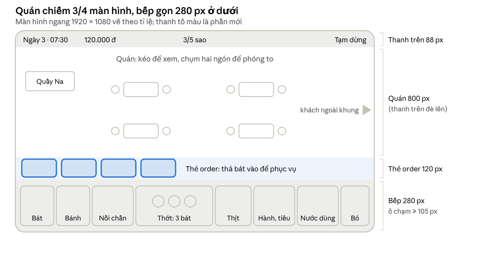
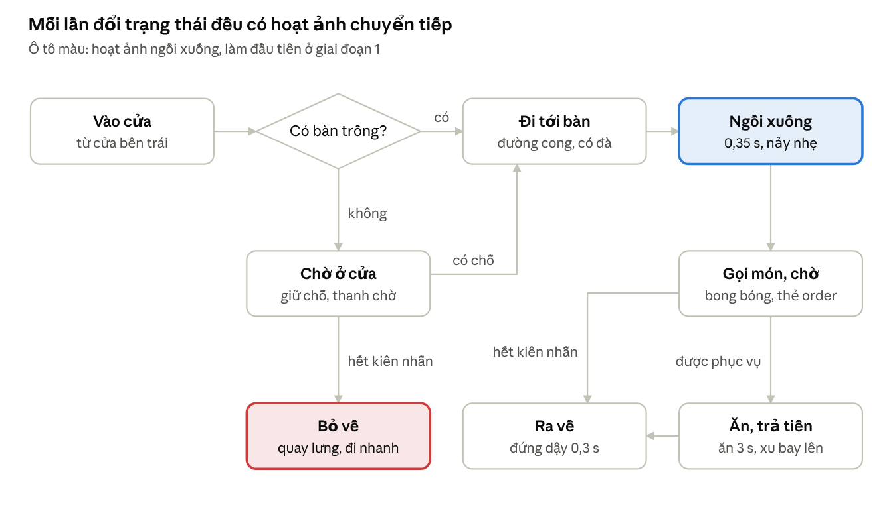

# Phở Phố Cổ – Kế hoạch UI/UX bản 2

Cập nhật 30/10/2026 · Bản gốc (sửa và bình luận được): https://claude.ai/artifact/Ni49cAZPo94SzW21s3q6Nh

Kế hoạch làm lại bản chơi thử để nhân vật đi, ngồi mượt và vừa tầm điện thoại: nhân vật nhỏ lại còn 190 px, bàn ghế to lên theo lưới ô 96 px, bếp gọn còn 280 px và phục vụ bằng thẻ order. Làm theo 5 giai đoạn, bắt đầu từ tỉ lệ và chuyển động.

## Vì sao bản hiện tại chưa mượt

Bản chơi thử giật và lệch tỉ lệ vì 5 nguyên nhân gốc, nên chỉnh vài thông số là không đủ mà phải đổi cách làm.

| Vấn đề bạn thấy                  | Nguyên nhân gốc                                                                                | Cách sửa trong kế hoạch này                                                               |
|----------------------------------|------------------------------------------------------------------------------------------------|-------------------------------------------------------------------------------------------|
| Nhân vật đi như trượt trên sàn   | Mỗi khách chỉ là một ảnh đứng tĩnh, code nhún lên xuống; không có bước chân, không quay mặt    | Nhân vật dựng xương cắt khớp, có hoạt ảnh đi 3 hướng, ngồi, ăn; tốc độ khớp với nhịp bước |
| Bàn ghế quá nhỏ, nhân vật quá to | Nhân vật cao 300 px còn bàn 170 px; mỗi thứ tự chọn kích thước, không theo lưới chung          | Lưới ô 96 px: nhân vật cao 2 ô (190 px), bàn chiếm 2 × 1,5 ô; mọi đồ vật theo bảng tỉ lệ  |
| Đi góc vuông, dừng khựng         | Đường đi là các đoạn thẳng gấp khúc, không có quán tính                                        | Tìm đường bằng AStarGrid2D, bo cong góc, tăng tốc và giảm tốc                             |
| Hình giật, nóng máy              | Nền quán và bếp vẽ lại bằng code ở mọi khung hình, hàng nghìn nét mỗi giây                     | Nền là ảnh tĩnh tách lớp; chỉ hiệu ứng nhỏ mới chuyển động                                |
| Khó thao tác trên điện thoại     | Bếp chiếm 1/3 màn hình; phải kéo bát trúng một nhân vật nhỏ khi quán đang phóng to hay thu nhỏ | Bếp gọn 280 px, ô chạm ≥ 105 px; thả bát vào thẻ order cố định thay vì nhắm vào người     |

## Nguyên tắc cho điện thoại màn hình ngang

Mọi màn hình và thao tác trong game phải đạt 8 nguyên tắc dưới đây. Các con số tính theo độ phân giải gốc 1920 × 1080.

1.  **Không viền đen:** dùng stretch canvas_items với aspect expand. Máy 19,5:9 sẽ thấy quán rộng hơn, không bị viền đen hai bên. Giao diện neo theo mép màn hình và tránh vùng tai thỏ, lấy từ DisplayServer.get_display_safe_area().

2.  **Ô chạm tối thiểu 105 × 105 px**, tương đương 48 dp trên Android hoặc 44 pt trên iOS khi chạy trên máy 6 inch. Vùng chạm của khách và đồ vật nhỏ được làm rộng hơn hình vẽ.

3.  **Cỡ chữ:** nội dung từ 32 px, nhãn phụ từ 24 px, không chữ nào dưới 22 px.

4.  **Vùng ngón cái:** thao tác nấu nằm ở nửa dưới. Thông tin (giờ, tiền, sao) ở trên cùng. Nút tạm dừng ở góc trên bên phải, xa chỗ thao tác để không chạm nhầm.

5.  **Kéo hoặc chạm đều được:** thao tác kéo nào cũng làm được bằng cách chạm vào vật cần kéo rồi chạm vào chỗ cần thả.

6.  **Phản hồi ngay:** trong vòng 100 ms sau mỗi lần chạm phải có phản hồi: hình phóng nhẹ, tiếng động hoặc rung.

7.  **60 hình/giây ổn định:** đổi từ trạng thái này sang trạng thái khác luôn có chuyển tiếp 0,1–0,35 s, không để hình nhảy cóc.

8.  **Camera không tự chạy** khi người chơi đang chạm hoặc kéo.

## Bố cục màn hình

Quán chiếm khoảng 3/4 màn hình, bếp thu gọn còn 280 px. Giữa hai phần là thanh thẻ order, nơi thả bát để phục vụ.

| Vùng            | Vị trí                                     | Kích thước (px gốc)        | Nội dung                                                                                                                      |
|-----------------|--------------------------------------------|----------------------------|-------------------------------------------------------------------------------------------------------------------------------|
| Thanh trên      | Trên cùng, nằm đè lên quán, nền trong suốt | Cao 88                     | Ngày và giờ, tiền, 5 sao, nút tạm dừng và cài đặt                                                                             |
| Quán            | Giữa                                       | Rộng hết màn hình, cao 800 | Bàn ghế, khách, quầy của Na; kéo để xem, chụm hai ngón để phóng to                                                            |
| Thanh thẻ order | Đáy vùng quán, ngay trên bếp               | Cao 120; mỗi thẻ 170 × 110 | Mỗi khách đang chờ món có một thẻ: mặt khách, số bàn, món vẽ bằng biểu tượng, thanh kiên nhẫn. Nhiều hơn 6 thẻ thì vuốt ngang |
| Bếp             | Đáy màn hình, cố định                      | Cao 280                    | 8 ô trạm nấu, mỗi ô rộng từ 150 px trở lên                                                                                    |

Thẻ order có kích thước cố định, không đổi theo mức phóng to. Nhờ vậy phục vụ không còn phụ thuộc vào việc nhắm trúng một nhân vật nhỏ trong quán.

bố cục màn hình ngang · 4 vùng

Bếp và thanh thẻ order luôn đứng yên; chỉ phần quán ở giữa cuộn và phóng to.

## Tỉ lệ nhân vật và nội thất

Mọi thứ trong quán đặt theo lưới ô vuông 96 px, đo ở mức phóng 1,0. Nhân vật nhỏ lại còn cao 2 ô, còn bàn ghế to lên: mặt bàn cao khoảng 2/3 người đứng, đúng kiểu bàn thấp, ghế đẩu của quán phở.

| Đồ vật                   | Kích thước ở mức phóng 1,0    | So với khách đứng | Ghi chú                                       |
|--------------------------|-------------------------------|-------------------|-----------------------------------------------|
| Khách đứng               | Cao 190 px, rộng khoảng 95 px | 1                 | Đầu chiếm khoảng 2/5 chiều cao, giống concept |
| Khách ngồi               | Phần nhìn thấy cao 125 px     | 0,66              | Ngồi nghiêng cạnh bàn, thấy rõ dáng ngồi      |
| Na sau quầy              | Cao 200 px                    | 1,05              | To hơn khách một chút cho dễ nhận ra          |
| Bàn tre thấp 2 ghế       | 200 × 120 px, chiếm 2 × 1,5 ô | Mặt bàn cao 0,65  | Bàn mặc định của quán                         |
| Bàn tre lớn 4 ghế        | 260 × 150 px                  |                   | Mở khóa khi nâng cấp                          |
| Ghế đẩu tre              | 80 × 60 px                    | Cao tới đầu gối   | Hai ghế hai bên mỗi bàn                       |
| Bát phở trên bàn         | 48 px                         |                   | Đủ lớn để thấy hơi nóng bốc lên               |
| Mèo                      | 70 px                         | 0,37              |                                               |
| Bong bóng trên đầu khách | 64 px, một biểu tượng món     |                   | Chi tiết đầy đủ nằm ở thẻ order               |
| Vùng chạm của khách      | 140 × 220 px                  | Lớn hơn hình      | Chạm hơi lệch vẫn trúng                       |

Quán cấp 1 có 4 bàn × 2 ghế = 8 chỗ ngồi, rộng 22 × 11 ô (2112 × 1056 px). Ở mức phóng 1,0 trên máy 19,5:9, bạn thấy gần hết chiều ngang quán và chỉ cần cuộn dọc một ít. Mở rộng quán thì thêm cột ô sang phải.

## Camera: cuộn và phóng to

Camera mất nhiều công nhất khi làm nhưng tạo khác biệt lớn nhất về cảm giác mượt. Logic này nằm riêng trong một script CameraRig.

- **Khung mặc định:** mức phóng 1,0, thấy trọn khu bàn. Nhấn đúp để quay về khung này trong 0,3 s.

- **Phóng to, thu nhỏ:** giới hạn trong khoảng 0,85–1,6, lấy tâm là điểm giữa hai ngón tay. Trên máy tính dùng lăn chuột hoặc chụm trên touchpad.

- **Cuộn có quán tính:** kéo một ngón để cuộn. Thả tay thì quán trượt tiếp và chậm dần trong khoảng 0,4 s.

- **Mép quán:** cho kéo quá 60 px rồi bật về trong 0,25 s, thay vì dừng cứng.

- **Khách ngoài khung nhìn:** nếu khách đang chờ nằm ngoài khung, ở mép màn hình hiện mũi tên kèm mặt khách. Chạm vào mũi tên (hoặc vào thẻ order) thì camera trượt tới chỗ khách trong 0,4 s.

- **Không tự chạy:** camera không bao giờ tự di chuyển khi người chơi đang chạm. Khi có khách mới vào, camera cũng không tự kéo theo.

- **Giới hạn khung:** tính theo mức phóng và chiều cao bếp, để khung nhìn không lộ ra ngoài quán và phần đáy quán không bị bếp che mất.

## Chuyển động nhân vật mượt

Nhân vật chỉ đi mượt khi có hoạt ảnh bước chân thật và đường đi cong mềm. Code nhún một ảnh tĩnh như bản hiện tại không bao giờ đạt được điều này.

### Cách làm hoạt ảnh

- **Dựng xương cắt khớp** bằng công cụ có sẵn trong Godot: Skeleton2D, Bone2D, Polygon2D. Điều khiển bằng AnimationPlayer và AnimationTree, không cần cài thêm plugin.

- **3 hướng nhìn cho mỗi nhân vật:** trước, sau, nghiêng. Hướng trái lấy từ hướng phải lật ngược lại.

- **Mỗi hướng tách 14 phần:** đầu, tóc trước, tóc sau, thân, 2 cánh tay trên, 2 cẳng tay, 2 bàn tay, 2 đùi, 2 cẳng chân kèm bàn chân.

- **Dùng chung xương:** mọi khách cùng một bộ xương và một bộ hoạt ảnh, chỉ thay bộ hình. Làm hoạt ảnh một lần là dùng được cho cả 9 kiểu khách.

- **Spine** là lựa chọn khác, có trả phí. Trước khi chọn cần kiểm tra Spine có bản chạy được với Godot 4.7 hay chưa.

| Hoạt ảnh           | Thời lượng                 | Lặp   | Ghi chú                                       |
|--------------------|----------------------------|-------|-----------------------------------------------|
| Đứng chờ (thở)     | 2 s                        | Có    | Vai nhún nhẹ 2 px                             |
| Đi (3 hướng)       | 0,8 s mỗi chu kỳ, 8 tư thế | Có    | Đi 140 px/s, mỗi bước 56 px, chân không trượt |
| Ngồi xuống         | 0,35 s                     | Không | Hạ hông 35 px, nảy nhẹ ở cuối                 |
| Ngồi chờ           | 2 s                        | Có    | Thỉnh thoảng nhìn quanh; gõ đũa khi sốt ruột  |
| Ăn                 | 1,2 s                      | Có    | Gắp, thổi, húp; hơi nóng bốc từ bát           |
| Vui, gật gù        | 0,6 s                      | Không | Khi nhận đúng món                             |
| Giận               | 0,6 s                      | Không | Dậm chân, khoanh tay                          |
| Đứng dậy           | 0,3 s                      | Không |                                               |
| Trả tiền, vẫy chào | 0,5 s                      | Không | Đồng xu bay lên                               |

Khi đổi từ hoạt ảnh này sang hoạt ảnh khác, AnimationTree luôn trộn chuyển tiếp trong 0,1–0,15 s.

### Đường đi

1.  **Tìm đường trên lưới** bằng AStarGrid2D, mỗi ô 48 px. Ô có bàn, ghế, quầy được đánh dấu là không đi qua được.

2.  **Rút gọn đường:** bỏ các điểm thừa khi đi thẳng được.

3.  **Bo cong các góc** bằng Curve2D với bán kính khoảng 40 px. Nhân vật đi theo khoảng cách dọc đường cong nên tốc độ luôn đều.

4.  **Tăng tốc và giảm tốc:** từ 0 lên 140 px/s trong 0,2 s, giảm dần ở 40 px cuối.

5.  **Quay mặt:** hướng mặt đổi theo hướng đi qua BlendSpace2D, trộn 0,12 s để quay người không bị giật.

6.  **Giữ chỗ trước:** mỗi ghế và mỗi chỗ đứng chờ được giữ cho một khách trước khi khách đó đi tới. Hai khách đi gần nhau thì người đi sau chậm lại.

### Trình tự ngồi xuống (khoảng 0,9 s)

1.  Đi tới điểm đứng cạnh ghế.

2.  Quay mặt về phía bàn (0,1 s).

3.  Chạy hoạt ảnh ngồi xuống (0,35 s), nảy nhẹ khi chạm ghế (0,1 s).

4.  Chuyển sang ngồi chờ. Bong bóng order bật lên trong 0,25 s (phóng từ 0 lên 1,1 rồi về 1), đồng thời thẻ order xuất hiện.

Mỗi bàn có 2 ghế hai bên, khách ngồi nghiêng nên thấy rõ dáng ngồi. Bàn lớn có thêm ghế phía sau (khách quay mặt ra ngoài) và ghế phía trước (khách quay lưng lại).

trạng thái của khách · 8 trạng thái, 2 lối bỏ về

Khách bỏ về ở hai lúc: đứng chờ ở cửa quá lâu, hoặc ngồi chờ món quá lâu. Trường hợp sau, khách vẫn đứng dậy có hoạt ảnh rồi mới đi ra.

## Luồng nấu và phục vụ

Bếp vẫn nấu đủ 7 bước của phở bò. Điểm khác là bếp được dựng bằng Control và cơ chế kéo thả có sẵn của Godot (\_get_drag_data, \_can_drop_data, \_drop_data, set_drag_preview). Nhờ đó chạm chính xác hơn, và chuột với ngón tay hoạt động giống hệt nhau.

1.  Chạm chồng bát để đặt bát lên thớt (tối đa 3 bát).

2.  Kéo nắm bánh phở vào rổ chần. Thanh thời gian hiện ngay trên miệng nồi.

3.  Khi vạch vào vùng xanh, kéo rổ chần đổ bánh vào bát.

4.  Xếp thịt tái hoặc chín lên mặt bánh.

5.  Kéo môi từ nồi nước dùng sang bát, giữ tay để chan. Mực nước và vạch xanh hiện ngay cạnh bát.

6.  Rắc hành và tiêu nếu khách gọi.

7.  Thả bát vào thẻ order của khách, hoặc chạm bát rồi chạm thẻ.

**Phục vụ qua thẻ order:**

- Thả bát vào thẻ thì bát bay theo đường cong tới đúng bàn (0,45 s), khách nhận bát và bắt đầu ăn.

- Vẫn có thể thả bát thẳng vào người khách trong quán.

- Khi bát đang chọn đúng với order, viền thẻ sáng xanh. Có thể tắt gợi ý này trong cài đặt.

- Chạm vào thẻ (không cầm bát) thì camera trượt tới chỗ khách đó.

**Thẻ order vẽ bằng biểu tượng:** bát phở, lát thịt hồng (tái) hoặc nâu (chín), cọng hành (gạch chéo nếu không hành), chấm tiêu. Bên dưới có dòng chữ nhỏ cho người mới. Thanh kiên nhẫn đổi cả màu lẫn độ dày, người mù màu vẫn nhận ra.

**Làm sai:** kéo bát vào giỏ bỏ, mất một ít tiền nguyên liệu. Không có nút hoàn tác, giống nấu thật.

## Hướng dẫn người mới

Người mới được dạy dần qua 5 ngày đầu, mỗi ngày thêm một ít, thay vì học hết trong một lần.

**Nguyên tắc khi hướng dẫn:**

- Mỗi lần chỉ dạy một thao tác. Lời thoại tối đa 2 dòng.

- Làm tối màn hình (lớp phủ đen 60 %), chừa một lỗ sáng đúng chỗ cần chạm. Chạm vào chỗ khác không có tác dụng.

- Một bàn tay mẫu di chuyển từ chỗ cầm tới chỗ thả, lặp lại cho đến khi người chơi làm theo.

- Ngày đầu không tính giờ, khách không bao giờ hết kiên nhẫn.

- Luôn có nút **Bỏ qua**, và nút **?** để xem lại bất cứ lúc nào.

- Sau phần hướng dẫn, nếu người chơi đứng yên 5 s trong khi có việc cần làm, ô cần chạm sẽ nhấp nháy nhẹ để nhắc.

- Quán chỉ đón khách sau khi người chơi tự nhấn **Mở cửa**.

| Ngày | Dạy thêm                                                      | Lượng khách                                                |
|------|---------------------------------------------------------------|------------------------------------------------------------|
| 1    | Cả quy trình phở tái có hành; cách xem quanh quán và phóng to | 1 khách có hướng dẫn, sau đó 2 khách tự làm (vẫn có gợi ý) |
| 2    | Phở chín, phở tái chín; khách dặn "không hành"                | 8–10 khách, quán vắng                                      |
| 3    | Rắc tiêu; khách chờ ở cửa khi hết bàn; dọn bàn                | 12–15 khách                                                |
| 4    | Giờ cao điểm buổi sáng và buổi tối                            | 18–22 khách                                                |
| 5    | Nhà phê bình khó tính                                         | 20–25 khách                                                |

Mỗi khi có thao tác mới, game hiện một thẻ giới thiệu ngắn gồm một câu và ảnh động minh họa, rồi dẫn người chơi làm thử một lần.

## Phản hồi cho từng thao tác

Thao tác nào cũng có phản hồi bằng hình, kèm âm thanh, và có rung ở những thao tác quan trọng. Phản hồi tốt giúp thao tác đã tay ngay cả khi hình vẽ còn đơn giản.

| Thao tác          | Hình                                            | Âm thanh                | Rung  |
|-------------------|-------------------------------------------------|-------------------------|-------|
| Nhấc đồ lên       | Đồ phóng to 1,1 lần, có bóng đổ                 | "Cạch" nhẹ              | 10 ms |
| Thả đúng chỗ      | Nảy nhẹ, lấp lánh                               | "Tách"                  | 15 ms |
| Thả sai chỗ       | Đồ bay về chỗ cũ trong 0,2 s, lắc nhẹ           | Tiếng "tặc" nhỏ         | Không |
| Vớt bánh đúng lúc | Lấp lánh xanh, chữ "Vừa chín!"                  | "Ting"                  | 15 ms |
| Chan nước dùng    | Dòng nước chảy, mực nước dâng, thịt tái đổi màu | Tiếng rót nước liên tục | Không |
| Phục vụ           | Bát bay tới bàn, khách cười                     | "Xoẹt"                  | 20 ms |
| Khách trả tiền    | Đồng xu bay về ô tiền, số tiền chạy lên         | "Leng keng"             | 10 ms |
| Khách sắp bỏ đi   | Bong bóng và thẻ order lắc, chuyển đỏ           | Tiếng "hừm"             | Không |

Rung dùng Input.vibrate_handheld(); trên Android cần bật quyền VIBRATE khi xuất game. Cài đặt có nút tắt riêng cho rung, âm thanh và nhạc.

## Hiệu năng

Mục tiêu: chạy ổn định 60 hình/giây trên Android tầm trung từ đời 2022 và iPhone 11 trở lên. Mỗi hình xử lý trong tối đa 16,6 ms, game dùng không quá 400 MB bộ nhớ.

- **Không vẽ lại bằng code ở mọi khung hình.** Nền quán là ảnh tách lớp hoặc TileMapLayer. Bếp là các Control có sẵn ảnh. Đây là nguyên nhân giật lớn nhất của bản hiện tại.

- **Gộp ảnh vào atlas** theo nhóm (nhân vật, nội thất, giao diện) để giảm số lần vẽ, mục tiêu dưới 80 lần mỗi khung hình.

- **Nén ảnh:** ảnh trong quán nén VRAM (ETC2 hoặc ASTC). Ảnh giao diện giữ không nén để chữ và viền sắc nét.

- **Hiệu ứng nhẹ:** hơi nóng và đồng xu dùng CPUParticles2D với số hạt nhỏ (hơi nóng tối đa 12 hạt mỗi nồi).

- **Dùng lại đối tượng:** chữ bay và đồng xu lấy từ một kho dùng chung, không tạo mới liên tục.

- **Y-sort:** chỉ bật cho lớp nhân vật và đồ vật, khoảng 40 node.

- **Chữ trên giao diện** chỉ cập nhật khi giá trị đổi, không gán lại mỗi khung hình.

- **Renderer Compatibility** để chạy được cả trên máy yếu.

- **Đo đạc:** dùng Profiler của Godot, chạy thật qua One-click deploy trên ít nhất 3 máy: 1 Android yếu, 1 Android tầm trung, 1 iPhone.

## Kiến trúc trong Godot

Thay vì một file main.gd dài 2.000 dòng như bản thử, game được tách thành các cảnh nhỏ, dùng lại được. Thông số nằm trong các file dữ liệu riêng nên chỉnh được mà không phải sửa code.

| Thành phần                                     | Loại                  | Việc                                                                                    |
|------------------------------------------------|-----------------------|-----------------------------------------------------------------------------------------|
| Game                                           | Autoload              | Trạng thái ngày, tiền, sao, lưu game                                                    |
| Audio                                          | Autoload              | Âm thanh, nhạc, rung; bật tắt theo cài đặt                                              |
| Restaurant.tscn                                | Cảnh                  | Nền quán, lưới tìm đường, lớp nhân vật có y-sort, các bàn                               |
| Table.tscn                                     | Cảnh                  | Ảnh bàn và ghế, Marker2D cho từng ghế và điểm đứng cạnh ghế                             |
| Customer.tscn                                  | Cảnh                  | Bộ xương và AnimationTree, script trạng thái, bong bóng order                           |
| CameraRig.gd                                   | Script                | Kéo, phóng to, quán tính, giới hạn khung, mũi tên chỉ khách                             |
| KitchenUI.tscn                                 | Cảnh trên CanvasLayer | Các trạm nấu, thớt 3 bát, thanh thẻ order                                               |
| Station.tscn, BowlSlot.tscn, OrderTicket.tscn  | Cảnh con              | Kéo thả bằng API có sẵn của Control                                                     |
| Tutorial.tscn                                  | Cảnh                  | Lớp phủ khoét lỗ (shader), bàn tay mẫu, hộp thoại; các bước khai báo trong file dữ liệu |
| CustomerType.tres, Recipe.tres, DayConfig.tres | Resource              | Thông số khách, công thức, lượng khách từng ngày                                        |

## Hình và âm thanh cần làm thêm

Bộ concept hiện có chỉ dùng được làm mẫu, vì mỗi nhân vật mới có một tư thế đứng và các đồ vật vẽ không cùng tỉ lệ. Để làm hoạt ảnh, họa sĩ cần vẽ lại từng phần theo bảng dưới đây.

| Hạng mục             | Số lượng                          | Yêu cầu                                                                   |
|----------------------|-----------------------------------|---------------------------------------------------------------------------|
| Bộ phần cho khách    | 9 kiểu × 3 hướng                  | Mỗi hướng tách 14 phần; cùng tỉ lệ, khớp với một bộ xương chung           |
| Bộ phần cho Na và Tí | 2 nhân vật × 3 hướng              | Thêm tư thế nấu và bưng khay                                              |
| Nền quán             | 1 bộ                              | Sàn, vách, mái tách lớp; không có người; cùng góc nhìn 3/4                |
| Nội thất đúng tỉ lệ  | Bàn 2 cỡ, ghế, quầy, cửa          | Vẽ theo lưới ô 96 px                                                      |
| Bộ giao diện         | Khoảng 30 mảnh                    | Nút, khung, thẻ order, thanh tiến trình theo chất liệu tre và rơm         |
| Biểu tượng order     | 8                                 | Tái, chín, tái chín, có hành, không hành, tiêu, phở bò, phở gà (dùng sau) |
| Hiệu ứng             | 6                                 | Hơi nóng, nước bắn, lấp lánh, đồng xu, bụi, trái tim                      |
| Âm thanh             | Khoảng 25 tiếng và 2 bản nhạc nền | Theo bảng phản hồi ở trên, thêm tiếng bếp và tiếng phố                    |

Trong lúc chờ họa sĩ, giai đoạn 1 tạm dùng 5 phần tách sẵn của Na (thân, 2 tay, 2 chân) để thử chuyển động.

## Lộ trình và tiêu chí hoàn thành

Toàn bộ mất khoảng 6–7 tuần với 1 lập trình viên và 1 họa sĩ. Giai đoạn 1 giải quyết đúng hai điều bạn chưa hài lòng: tỉ lệ và độ mượt.

| Giai đoạn                   | Thời gian                              | Kết quả                                                                          | Xong khi                                                                                          |
|-----------------------------|----------------------------------------|----------------------------------------------------------------------------------|---------------------------------------------------------------------------------------------------|
| 1\. Tỉ lệ và chuyển động    | 1–1,5 tuần                             | Quán xếp theo lưới ô, CameraRig, 1 khách dựng xương tạm biết đi, ngồi, ăn, ra về | 10 khách cùng lúc vẫn 60 hình/giây trên điện thoại thật; chân không trượt; không đi xuyên bàn ghế |
| 2\. Bếp và phục vụ          | 1 tuần                                 | Bếp kéo thả bằng Control, thanh thẻ order, bát bay tới bàn, đủ phản hồi          | Người mới nấu xong một bát trong tối đa 25 s sau hướng dẫn; mọi ô chạm từ 105 px trở lên          |
| 3\. Hướng dẫn và nhịp ngày  | 1 tuần                                 | Lớp phủ khoét lỗ, bàn tay mẫu, nội dung ngày 1–5                                 | 4/5 người chơi thử qua ngày 1 mà không cần hỏi                                                    |
| 4\. Đồ họa thật và âm thanh | 2–3 tuần, làm song song từ giai đoạn 2 | Bộ phần cho 9 khách, nền quán, bộ giao diện, âm thanh                            | Không còn hình tạm                                                                                |
| 5\. Tối ưu và chơi thử      | 1 tuần                                 | Đo hiệu năng trên 3 máy, sửa theo góp ý của 5–10 người                           | Đạt mục tiêu hiệu năng; không còn lỗi làm kẹt game                                                |

## Câu hỏi cần chốt

- [ ] Giữ màn hình ngang như hiện tại?

- [ ] Ai vẽ bộ phần nhân vật: họa sĩ trong đội hay thuê ngoài?

- [ ] Dựng xương bằng công cụ có sẵn của Godot (đề xuất) hay dùng Spine?

- [ ] Máy nào là máy thử chính (hãng, đời máy)?

- [ ] Quán cấp 1 có 4 bàn × 2 ghế có hợp không?

- [ ] Phục vụ bằng cách thả bát vào thẻ order có ổn không, hay bạn muốn Na tự bưng ra bàn?
